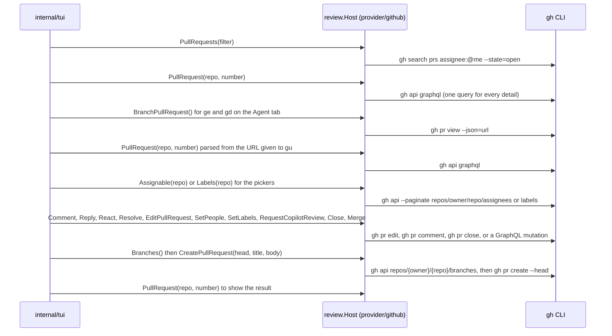

# Pull requests

The **Pull Request** tab talks to GitHub through the `gh` CLI, so Revunk reuses the user's existing sign in and needs no token handling or HTTP client of its own.

## Flow

## Decisions

| Decision                                                                                | Reason                                                                                                                                                                                                                                                                                                                                   |
| --------------------------------------------------------------------------------------- | ---------------------------------------------------------------------------------------------------------------------------------------------------------------------------------------------------------------------------------------------------------------------------------------------------------------------------------------- |
| One GraphQL query loads a pull request's details, threads, reactions, and checks        | The sidebar, its tabs, and the review diff comments all read the same `review.PullRequest`, and a single request per refresh stays well under GitHub's rate limits                                                                                                                                                                       |
| The review diff is a second `tui.Model` built on a `review.Service`                     | It gets every Agent diff feature for free. `github.Source` serves the diff and `github.Review` maps review threads to `review.Comment`                                                                                                                                                                                                   |
| `reviewPullRequest` holds every difference of the review diff                           | It is the one place that turns off sending to an agent, copying, `DD`, and the general comment, and sets the 15 second refresh, so the rest of the diff code stays shared                                                                                                                                                                |
| Messages from the review diff are wrapped in `nestedMsg` with a generation number       | Both models use the same message types, so the outer model routes them, and messages from a closed diff are dropped                                                                                                                                                                                                                      |
| Review comments go to the viewer's pending review                                       | It matches GitHub, where comments stay private until the review is submitted from the actions. Submitting reuses the pending review, or creates the review when there is none                                                                                                                                                            |
| Viewed files stay in `.git/revunk.json` under `owner/repo#number`                       | GitHub's viewed state needs its own mutations and resets differently, and the local store already handles it                                                                                                                                                                                                                             |
| Refresh every 10 seconds for the list and sidebar, 15 seconds for the review diff       | Checks and comments show up close to real time. Only the visible view polls, nothing polls while the terminal is unfocused, and each failed refresh doubles the interval up to 32 times, so the worst case stays near 500 REST calls, 360 GraphQL points, and 6 searches a minute out of GitHub's 5,000 an hour and 30 searches a minute |
| `gu` accepts only `github.com` pull request URLs                                        | Every request goes through `gh` to its default host, so a URL on another host would fail later with a less clear error. `review.ParsePullRequestURL` also reads the URL `gh pr view` returns for `ge` and `gd`                                                                                                                           |
| Outdated review threads show in the **Comments** tab only                               | Their lines no longer exist in the diff, like GitHub's files view                                                                                                                                                                                                                                                                        |
| Merging uses the `mergePullRequest` mutation, pinned to the loaded head commit          | A push after the pull request loaded makes GitHub refuse instead of merging commits nobody saw. The methods come from the repository's settings and the warning from `mergeStateStatus`, both in the same query, while GitHub's own checks still decide                                                                                  |
| Pull request actions live in one searchable list behind `A`                             | Fewer keys to remember. `ge`, `gd`, and `gu` keep their keys and are listed too, and the list is built per context so the review diff leaves out what can't run there                                                                                                                                                                    |
| The merge commit message comes from `viewerMergeHeadlineText` and `viewerMergeBodyText` | They are the defaults GitHub's merge box shows, following the repository's commit message settings, and they load in the same query                                                                                                                                                                                                      |
