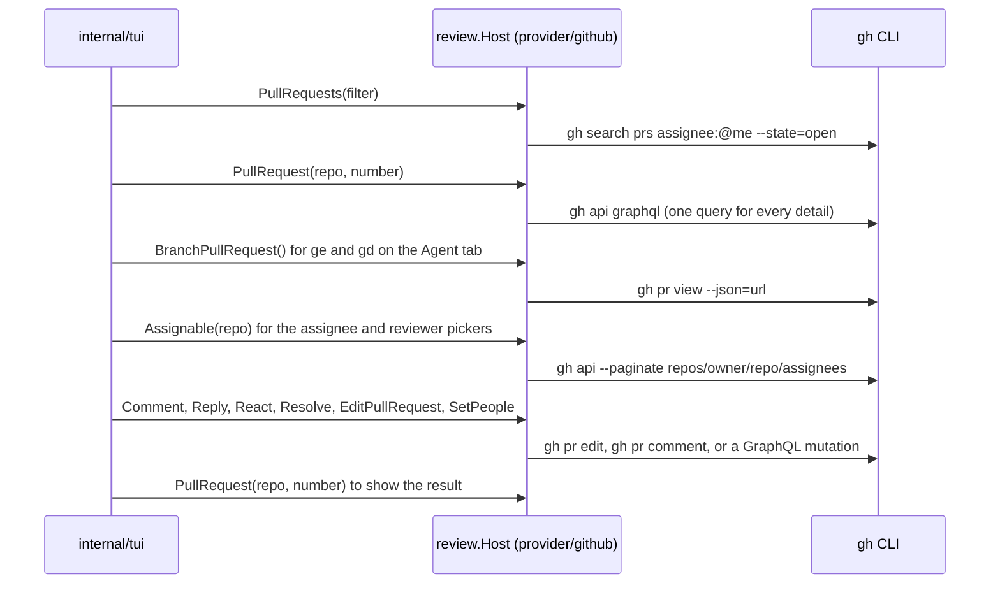

# Pull requests

The **Pull Request** tab talks to GitHub through the `gh` CLI, so Revunk reuses the user's existing sign in and needs no token handling or HTTP client of its own.

## Flow

## Decisions

| Decision                                                                          | Reason                                                                                                                                                                 |
| --------------------------------------------------------------------------------- | ---------------------------------------------------------------------------------------------------------------------------------------------------------------------- |
| One GraphQL query loads a pull request's details, threads, reactions, and checks  | The sidebar, its tabs, and the review diff comments all read the same `review.PullRequest`, and a single request per refresh stays well under GitHub's rate limits     |
| The review diff is a second `tui.Model` built on a `review.Service`               | It gets every Agent diff feature for free. `github.Source` serves the diff and `github.Review` maps review threads to `review.Comment`                                 |
| `reviewPullRequest` holds every difference of the review diff                     | It is the one place that turns off sending to an agent, copying, and `DD`, turns on `gs`, and sets the 15 second refresh, so the rest of the diff code stays shared    |
| Messages from the review diff are wrapped in `nestedMsg` with a generation number | Both models use the same message types, so the outer model routes them, and messages from a closed diff are dropped                                                    |
| Review comments go to the viewer's pending review                                 | It matches GitHub, where comments stay private until the review is submitted with `gs`. Submitting reuses the pending review, or creates the review when there is none |
| Viewed files stay in `.git/revunk.json` under `owner/repo#number`                 | GitHub's viewed state needs its own mutations and resets differently, and the local store already handles it                                                           |
| Refresh every 10 seconds for the list and sidebar, 15 seconds for the review diff | Checks and comments show up close to real time with about 1,000 API calls an hour at most                                                                              |
| Outdated review threads show in the **Comments** tab only                         | Their lines no longer exist in the diff, like GitHub's files view                                                                                                      |
